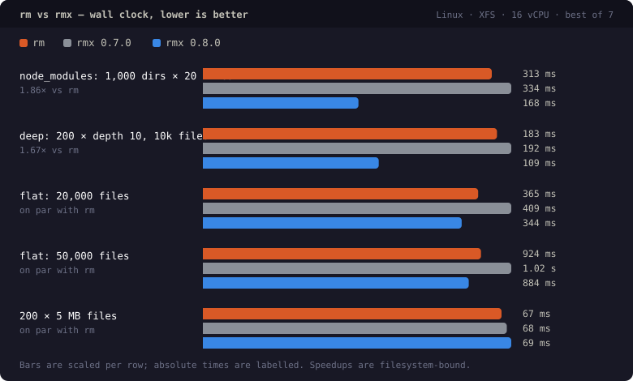

<div align="center">

# rmx

**A faster `rm`, written in Rust.**

[](https://github.com/ismoilovdevml/rmx/actions/workflows/ci.yml)
[](https://opensource.org/licenses/MIT)
[](https://www.rust-lang.org)


</div>

## Why

Deleting a large tree is bound by `unlink` syscalls, not by CPU. `rm` issues them
one at a time. `rmx` walks the tree on one thread and hands the unlinks to a small
pool of workers, and reports what it removed.

Drop-in for the flags you already use: `-r -f -i -v -d`, plus `--`,
`--preserve-root` and the `.`/`..` refusal you expect from `rm`.

## Install

```bash
curl -fsSL https://raw.githubusercontent.com/ismoilovdevml/rmx/main/install.sh | bash
```

The script verifies the archive against the release's `SHA256SUMS.txt` and
refuses to install if it does not match. `INSTALL_DIR=~/.local/bin` installs
somewhere else; `RMX_VERSION=v0.8.0` pins a version.

**Homebrew** (macOS, Linux)

```bash
brew tap ismoilovdevml/rmx https://github.com/ismoilovdevml/rmx
brew install ismoilovdevml/rmx/rmx
```

**Windows** — download `rmx-x86_64-pc-windows-msvc.zip` from
[Releases](https://github.com/ismoilovdevml/rmx/releases/latest), check it against
`SHA256SUMS.txt`, and put `rmx.exe` on your `PATH`.

<details>
<summary>Other methods</summary>

**Pre-built binaries** — [Releases](https://github.com/ismoilovdevml/rmx/releases/latest)

```bash
# pick your target: x86_64-unknown-linux-musl | aarch64-unknown-linux-musl
#                   x86_64-apple-darwin       | aarch64-apple-darwin
TARGET=aarch64-apple-darwin
BASE=https://github.com/ismoilovdevml/rmx/releases/latest/download
curl -fsSLO "$BASE/rmx-$TARGET.tar.gz" && curl -fsSLO "$BASE/SHA256SUMS.txt"
grep "rmx-$TARGET.tar.gz" SHA256SUMS.txt | shasum -a 256 -c -
tar xzf "rmx-$TARGET.tar.gz" && sudo install -m 755 rmx /usr/local/bin/
```

**cargo-binstall** (the name `rmx` on crates.io belongs to an unrelated
project, so point it at this repository)

```bash
cargo binstall --git https://github.com/ismoilovdevml/rmx rmx
```

**From source** (Rust 1.88+)

```bash
git clone https://github.com/ismoilovdevml/rmx.git && cd rmx
cargo build --release
sudo install -m 755 target/release/rmx /usr/local/bin/
```

**Uninstall**

```bash
curl -fsSL https://raw.githubusercontent.com/ismoilovdevml/rmx/main/uninstall.sh | bash
```

</details>

## Usage

```bash
rmx -rf node_modules/        # the common case
rmx -rfv build/              # show every removal
rmx -rfq cache/              # silent, for scripts
rmx -i secrets.env           # prompt first
rmx -d empty_dir/            # only if empty
rmx -- -weird-name.txt       # names that start with '-'
rmx -rn node_modules/        # dry run: what would go, how big
rmx -rf --async target/      # return at once, delete in the background
rmx -rfW ~/go/pkg/mod        # read-only caches (Go modules, Bazel)
```

| Flag | Meaning |
|---|---|
| `-r`, `-R`, `--recursive` | recurse into directories |
| `-f`, `--force` | ignore missing files, never prompt |
| `-i`, `--interactive` | prompt before each removal (`-ri` asks per entry) |
| `-v`, `--verbose` | print each path as it goes |
| `-d`, `--dir` | remove empty directories |
| `-q`, `--quiet` | no summary, skip `stat` per file |
| `-j`, `--jobs <N>` | unlink workers (default `min(cores, 4)`) |
| `-n`, `--dry-run` | walk and count, remove nothing (`-v` lists `would remove '…'`) |
| `-x`, `--one-file-system` | don't cross into other mounted file systems |
| `-W`, `--force-writable` | add `u+rwx` to read-only directories so their contents can go |
| `--async` | rename the tree aside instantly, delete it in a detached process |
| `--no-preserve-root` | allow `-r` on `/` (refused by default) |
| `--` | everything after is a path |
| `-V`, `--version` | print the version |


Also: `rmx upgrade`, `rmx check-update`, `rmx version`, `rmx about`. These are
only commands when given alone, so `rmx dev notes.txt` removes a file called
`dev`; use `rmx -- version` to remove a lone file named like a command.

### Behaviour you can rely on

- **Exit status is 1 if anything could not be removed**, and rmx keeps going with
  the other operands. `-f` only silences *missing* files; permission denied,
  read-only file system and the like are always reported.
- **Symlinks are never followed.** `rmx -rf link` removes the link. `rmx -rf link/`
  is refused instead of deleting the directory the link points to.
- **`/`, `.` and `..` are refused** (`rmx -rf /`, `rmx -rf .`, `rmx -rf dir/..`).
- The last of `-f` / `-i` wins, as in POSIX, so `alias rm='rmx -i'` still lets
  `rm -f` through.
- Colour only on a terminal; `NO_COLOR` turns it off.
- Hard-linked files (pnpm stores) are counted once in the size total.
- A one-line live counter appears on stderr when a deletion runs longer than
  300 ms and stderr is a terminal. Never in pipes, with `-v`, `-i` or `-q`.

### `--async`

`rmx -rf --async node_modules` renames each directory operand to a hidden
sibling (`.rmx-trash-<pid>-…`) — an atomic, instant rename within the same
directory — and hands it to a detached `rmx -rfq` process, so the prompt comes
back immediately and the name is free to reuse. Files are deleted in the
foreground as usual. If the rename is not possible (no write permission on the
parent), rmx deletes synchronously instead. If the background process is killed
(reboot, OOM), the `.rmx-trash-*` directory stays; remove it with `rmx -rf`.

### `--dry-run`

Runs the same walk with the same checks and errors, and reports what would be
removed — counts, size, and with `-v` every path — without touching anything.
It cannot foresee permission failures that only happen at unlink time.

## Performance



| Workload | `rm` | rmx 0.7.0 | **rmx 0.8.0** | vs `rm` |
|---|---|---|---|---|
| node_modules: 1,000 dirs × 20 files | 313 ms | 334 ms | **168 ms** | 1.86× |
| deep: 200 × depth 10, 10k files | 183 ms | 192 ms | **109 ms** | 1.67× |
| flat: 20,000 files | 365 ms | 409 ms | **344 ms** | 1.06× |
| flat: 50,000 files | 924 ms | 1.02 s | **884 ms** | 1.05× |
| 200 × 5 MB files | 67 ms | 68 ms | **69 ms** | 0.97× |

Linux, XFS on a 16-vCPU VM, GNU coreutils 9.7 `rm`. Best of 7, tree regenerated
and `sync`ed before every run, all three tools run back to back on the same tree
shape. Earlier macOS/APFS measurements of 0.7.0 are in the
[v0.7.0 README](https://github.com/ismoilovdevml/rmx/tree/v0.7.0#performance);
macOS/APFS numbers for the current release come from the
[macOS benchmark workflow](.github/workflows/bench-macos.yml), which anyone can
run from the Actions tab (`scripts/bench.py` is the same harness).

**Where it helps, and where it doesn't.** Trees with many directories —
`node_modules`, `target/`, `.venv`, monorepos — are where the new engine pays off,
because several directories are emptied at once. A single flat directory is on
par with `rm` on Linux: the kernel takes the parent directory's lock for every
unlink, so extra threads in one directory only queue (measured: 1 worker 926 ms,
2 workers 1,188 ms on 50k files). Large files are dominated by extent freeing
inside the kernel, and no user-space trick moves that.

### Windows

Windows uses a portable engine built on the standard library (no handle-relative
calls there), with the same flags, messages and exit codes. Differences:

- A read-only *file* is deleted anyway (its attribute is cleared), just as a
  `0444` file is on unix — otherwise `rmx -rf repo` would fail on every object
  git marks read-only. Read-only *directories* need `-W`, like unix.
- `-x` / `--one-file-system` is refused: stable Rust exposes no volume id.
- Hard links are counted once per link in the size total.
- `rmx upgrade` is not available yet; `rmx check-update` works.

## How it works

One walker thread goes depth-first without recursion, opening every directory
with `openat(O_DIRECTORY | O_NOFOLLOW)` and listing it with `readdir` (using the
entry type the filesystem reports, `fstatat` only when it is unknown). File names
are packed into shared batches of 128 that span many small directories and passed
over a bounded queue to the workers, which `unlinkat` them relative to the
directory's open descriptor — no path is rebuilt or re-resolved per file, and
there is no `PATH_MAX` limit.

Each open directory is reference-counted: the batches carrying its files and its
subdirectories hold references, and when the last one is released the directory
is closed and removed with `unlinkat(parent, name, AT_REMOVEDIR)`. If something
inside failed, the failure travels up instead, so you see the one real error and
not a cascade of "Directory not empty".

Each of these is a measured decision:

- **At most 4 workers.** `unlink` is a journalled metadata write; throughput
  saturates early. On the node_modules tree: 1 worker 317 ms, 2 → 206, **4 → 179**,
  6 → 184, 8 → 193.
- **One worker per directory on Linux.** See above; directories are listed in
  full first, and unlinked in inode order when they hold 10,000+ entries, as GNU
  `rm` does.
- **Small jobs never start a thread.** `rmx file.txt` stays ~1 ms.
- **Bounded file descriptors.** rmx raises the open-file soft limit at startup
  and caps how many directories are open at once, so very wide trees never hit
  `EMFILE`.
- **One dependency.** `libc`. Upgrades shell out to `curl` and verify SHA-256 in
  pure Rust; the release binary is about half a megabyte.

## Development

```bash
cargo build --release
cargo test
cargo clippy --all-targets -- -D warnings
cargo fmt
```

## License

MIT — see [LICENSE](LICENSE).

Inspired by [Manuchehr Usmonov's](https://github.com/yetimdasturchi) C implementation.
