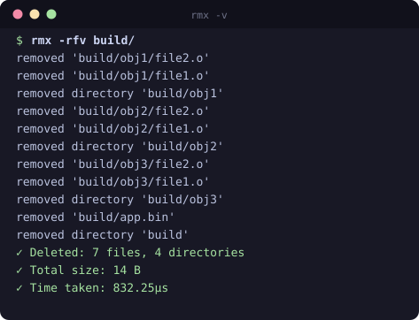

<div align="center">

# rmx

**A faster `rm`, written in Rust.**

[](https://github.com/ismoilovdevml/rmx/actions/workflows/ci.yml)
[](https://opensource.org/licenses/MIT)
[](https://www.rust-lang.org)


</div>

## Why

Deleting a large tree is bound by `unlink` syscalls, not by CPU. `rm` issues them
one at a time. `rmx` batches them across a small pool of threads, and reports what
it removed.

Drop-in for the flags you already use: `-r -f -i -v -d`.

## Install

```bash
curl -sSL https://raw.githubusercontent.com/ismoilovdevml/rmx/main/install.sh | bash
```

<details>
<summary>Other methods</summary>

**Pre-built binaries** — [Releases](https://github.com/ismoilovdevml/rmx/releases/latest)

```bash
# pick your target: x86_64-unknown-linux-musl | aarch64-unknown-linux-musl
#                   x86_64-apple-darwin       | aarch64-apple-darwin
TARGET=aarch64-apple-darwin
curl -sSL "https://github.com/ismoilovdevml/rmx/releases/latest/download/rmx-$TARGET.tar.gz" | tar xz
sudo mv rmx /usr/local/bin/
```

**From source**

```bash
git clone https://github.com/ismoilovdevml/rmx.git && cd rmx
cargo build --release
sudo cp target/release/rmx /usr/local/bin/
```

**Uninstall**

```bash
curl -sSL https://raw.githubusercontent.com/ismoilovdevml/rmx/main/uninstall.sh | bash
```

</details>

## Usage

```bash
rmx -rf node_modules/        # the common case
rmx -rfv build/              # show every removal
rmx -rfq cache/              # silent, for scripts
rmx -i secrets.env           # prompt first
rmx -d empty_dir/            # only if empty
```

| Flag | Meaning |
|---|---|
| `-r`, `-R`, `--recursive` | recurse into directories |
| `-f`, `--force` | ignore missing files, never prompt |
| `-i`, `--interactive` | prompt before each removal |
| `-v`, `--verbose` | print each path as it goes |
| `-d`, `--dir` | remove empty directories |
| `-q`, `--quiet` | suppress the summary and skip `stat` per file |



Also: `rmx upgrade`, `rmx check-update`, `rmx version`, `rmx about`.

## Performance


| Workload | `rm` | `rmx` | Speedup |
|---|---|---|---|
| 50,000 small files | 3.77 s | **1.68 s** | 2.24× |
| 200,000 small files | 17.26 s | **9.94 s** | 1.74× |
| 20,000 files / 500 nested dirs | 1.12 s | **0.72 s** | 1.56× |
| 200 × 5 MB | 42 ms | **40 ms** | 1.05× |

Best of 5 runs, tree regenerated and `sync`ed between runs. macOS / Apple Silicon
/ APFS, 12 cores.

**The gains are filesystem-bound, so treat these as one data point, not a
promise.** Many small files is where there is headroom. A few large files is
dominated by extent freeing inside the kernel, and no amount of user-space work
moves it — rmx is within noise of `rm` there, as it should be.

## How it works

Each of these is a measured decision, not an assumption. Several plausible
optimizations were tried and **reverted because they made it slower**.

- **The thread pool is capped at 4, not one-per-core.** `unlink` is a journalled
  metadata write, so throughput saturates early and then degrades under
  contention. On a 12-core box, 50k files: 1 thread 3052 ms → 4 threads 1843 ms →
  12 threads 2264 ms. Using every core costs ~20%.
- **Files are unlinked in parallel; directory recursion is sequential.** Fanning
  subdirectories across threads measured *slower* (738 → 840 ms on a 500-dir
  tree) — concurrent traversal contends on filesystem metadata locks. Large
  directories still saturate the pool, which is the case that matters.
- **Counters are batched.** Workers accumulate locally and commit once per chunk,
  instead of two atomic read-modify-writes per file.
- **`-v` buffers.** Output is built per chunk and emitted in one write rather than
  locking and flushing stdout per line — 1.44× on 50k files.
- **Byte accounting is kept because it turned out to be free.** The per-file
  `stat` looked like the obvious thing to cut, but `readdir` has already warmed
  the inode cache, so it never reaches disk: 2113 ms vs 2140 ms over 50k files.
  `-q` still skips it.

Symlinks are unlinked, never followed — `rmx -rf link-to-dir` removes the link
and leaves the target alone, matching `rm`.

## Development

```bash
cargo build --release
cargo test
cargo clippy --all-targets -- -D warnings
cargo fmt
```

## License

MIT — see [LICENSE](LICENSE).

Inspired by [Manuchehr Usmonov's](https://github.com/yetimdasturchi) C implementation.
